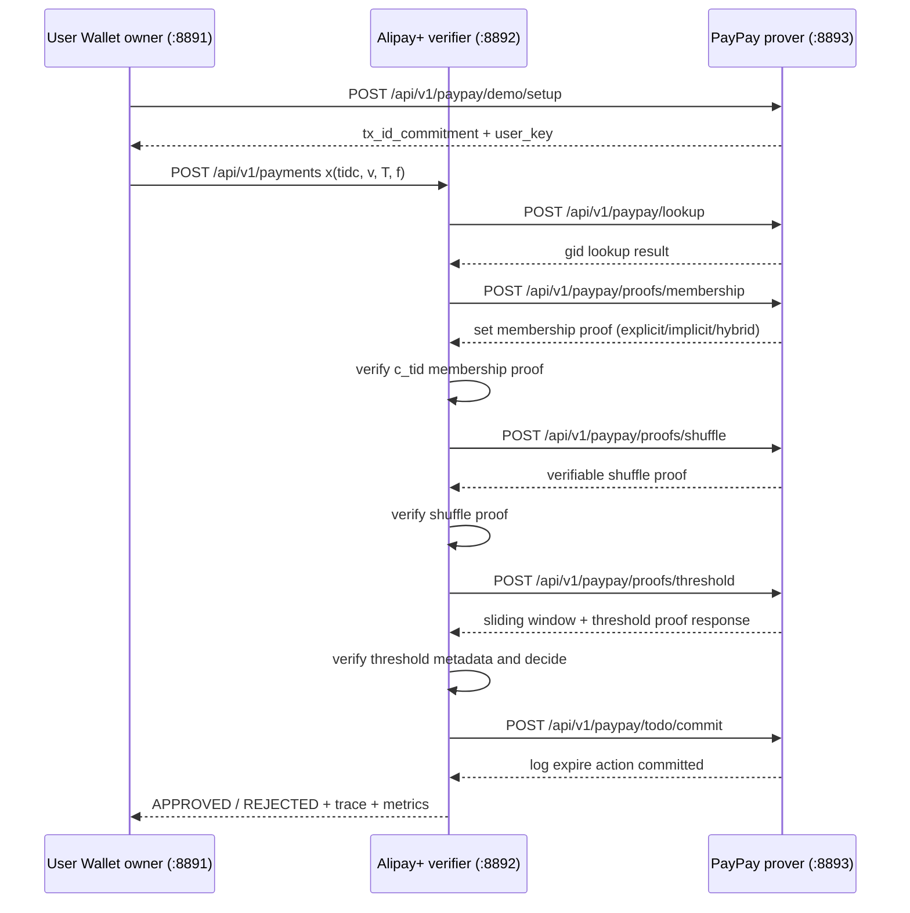

# Three-Server Dummy Integration Flow

Dokumen ini memetakan slide **"Keseluruhan Sistem"** dari `Identity Binding
Commitment_compressed.pdf` ke implementasi demo di repo ini.

## Keputusan Arsitektur

Project tetap memakai **satu Rust workspace / satu git repo**, tetapi sekarang
punya tiga binary HTTP terpisah:

| Entitas paper/demo | Binary | Default port | Peran |
| --- | --- | ---: | --- |
| User Wallet owner | `aml-wallet` | `8891` | Membuat payment request dan menerima hasil |
| Alipay+ client/verifier | `aml-alipay` | `8892` | Menerima request, memverifikasi proof, memutuskan approve/reject |
| PayPay server/prover | `aml-paypay` | `8893` | Menyimpan dummy state, lookup, generate proof, update todo log |
| Legacy all-in-one | `aml-api` | `8880` | Demo lama + audit endpoint SQLite |

Satu repo lebih aman untuk PoC karena kontrak DTO, test, dan dependency crypto
tetap konsisten. Binary tetap bisa dideploy sebagai tiga service berbeda.

## Alur HTTP



## Endpoint Utama

Wallet:

- `GET /`
- `POST /api/v1/wallet/payments`
- `POST /api/v1/wallet/metrics/run`
- `GET /api/v1/wallet/result/latest`

Alipay+:

- `POST /api/v1/payments`
- `GET /api/v1/traces/latest`
- `GET /api/v1/metrics/latest`
- `POST /api/v1/metrics/run`

PayPay:

- `POST /api/v1/paypay/demo/setup`
- `POST /api/v1/paypay/lookup`
- `POST /api/v1/paypay/proofs/membership`
- `POST /api/v1/paypay/proofs/shuffle`
- `POST /api/v1/paypay/proofs/threshold`
- `POST /api/v1/paypay/todo/commit`
- `GET /api/v1/metrics/latest`
- `POST /api/v1/metrics/run`

## Menjalankan Demo

```bash
cp .env.example .env
bash scripts/run_three_servers.sh
```

Buka:

```text
http://localhost:8891
```

Flow utama sekarang dimulai dari Wallet. `aml-api` lama tetap bisa dijalankan
untuk regression demo audit SQLite:

```bash
cargo run -p aml-api
```

Mode Set Membership untuk three-server demo dipilih lewat `.env`:

```bash
AML_MEMBERSHIP_MODE=explicit # default/current sigma rerandomization membership
AML_MEMBERSHIP_MODE=implicit # current Merkle membership proof
AML_MEMBERSHIP_MODE=hybrid   # current bucketed subset + explicit sigma proof
```

Timeout membership:

```bash
AML_MEMBERSHIP_WARN_TIMEOUT_MS=1000
AML_MEMBERSHIP_HARD_TIMEOUT_MS=30000
```

Warn timeout hanya catatan performa. Hard timeout 30 detik adalah safety guard,
bukan target sukses metric.

Default payment flow memakai `explicit` agar tetap kompatibel dengan baseline
shuffle-based yang sudah disetujui sebelumnya. Mode `implicit` dan `hybrid`
dapat dipilih lewat `.env` untuk demo alternatif, tetapi per request normal
tetap memakai satu mode. Perbandingan ketiga mode dilakukan lewat metrics
runner atau tombol **Run Membership Comparison** di UI Wallet.

Response membership dan response final Wallet sekarang membawa
`security_profile`/`membership_security_profile`. Field ini sengaja memisahkan:

- `current_primitive`: yang benar-benar berjalan di code;
- `formal_target`: target formal protocol;
- `formal_gap`: bagian yang belum diimplementasikan;
- `trust_anchor_current`: asumsi verifier saat ini;
- `trust_anchor_ideal`: trust anchor pada protokol formal.

Dengan ini demo tetap executable, tetapi tidak overclaim bahwa `explicit` sudah
Bayer-Groth, `implicit` sudah vector commitment, atau `hybrid` sudah global
commitment proof.

## Metrics

Runner stakeholder-friendly:

```bash
cargo run -p aml-metrics -- --runs 100 --n 100
```

Full report:

```bash
cargo run -p aml-metrics -- --runs 1000 --n 100
```

Filter mode tertentu:

```bash
cargo run -p aml-metrics -- --runs 1000 --n 100 --mode explicit
cargo run -p aml-metrics -- --runs 1000 --n 100 --modes explicit,implicit,hybrid
```

Endpoint metrics:

```bash
curl -s -X POST http://localhost:8892/api/v1/metrics/run \
  -H 'Content-Type: application/json' \
  -d '{"runs":100,"n":100,"modes":"explicit,implicit,hybrid"}' | jq .
```

Endpoint proxy dari Wallet UI:

```bash
curl -s -X POST http://localhost:8891/api/v1/wallet/metrics/run \
  -H 'Content-Type: application/json' \
  -d '{"runs":100,"n":100,"modes":"explicit,implicit,hybrid"}' | jq .
```

Report selalu memuat:

- `paper_target`
- `poc_implementation`
- `measured_value`
- `pass_fail_or_not_comparable`
- membership security fields: `current_primitive`, `formal_target`,
  `formal_gap`, dan `claim_level`

Untuk bagian yang di paper menargetkan Bayer-Groth atau SNARK penuh, verdict
ditulis `not_comparable` karena PoC memakai sigma shuffle dan simplified
oblivious update sesuai keputusan stakeholder.

Set membership metrics juga muncul di report:

- `Set membership proof generation time`
- `Set membership verification time`
- `Set membership proof size`

Untuk `n=100`, verdict membership memakai threshold:

| Mode | Gen target | Verify target | Size target |
| --- | ---: | ---: | ---: |
| `explicit` | 120 ms | 500 ms | 65536 bytes |
| `implicit` | 20 ms | 10 ms | 2048 bytes |
| `hybrid` | 60 ms | 80 ms | 16384 bytes |

Untuk ukuran selain `n=100`, verdict membership menjadi `scale_report` agar
angka dibaca sebagai laporan scaling, bukan klaim pass/fail baseline utama.

Cara membaca pilihan mode:

- `explicit`: current sigma rerandomization membership; paling dekat dengan
  pendekatan shuffle-based awal, tetapi belum formal shuffle proof.
- `implicit`: current Merkle membership proof; paling cepat dan proof paling
  kecil pada PoC saat ini, tetapi belum KZG/vector commitment production.
- `hybrid`: current bucketed subset + explicit sigma proof; kompromi performa,
  tetapi belum punya `pi_global` terhadap trusted global root `R_S`.

Target formal protocol didokumentasikan di
`docs/SET_MEMBERSHIP_FORMALIZATION.md` dan
`output/pdf/set_membership_formalization.pdf`.

## Batas PoC

Integrasi ini sudah menunjukkan boundary tiga server via HTTP, tetapi belum
berarti integrasi real dengan Alipay+ atau PayPay production. State PayPay masih
dummy/in-memory, auth antar server belum production-grade, dan proof verification
tetap mengikuti pendekatan hybrid yang dijelaskan di `HYBRID_APPROACH.md`.

Spesifikasi minimum server dan cara deploy ke tiga mesin berbeda ada di
`SERVER_REQUIREMENTS.md`.
